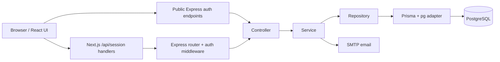
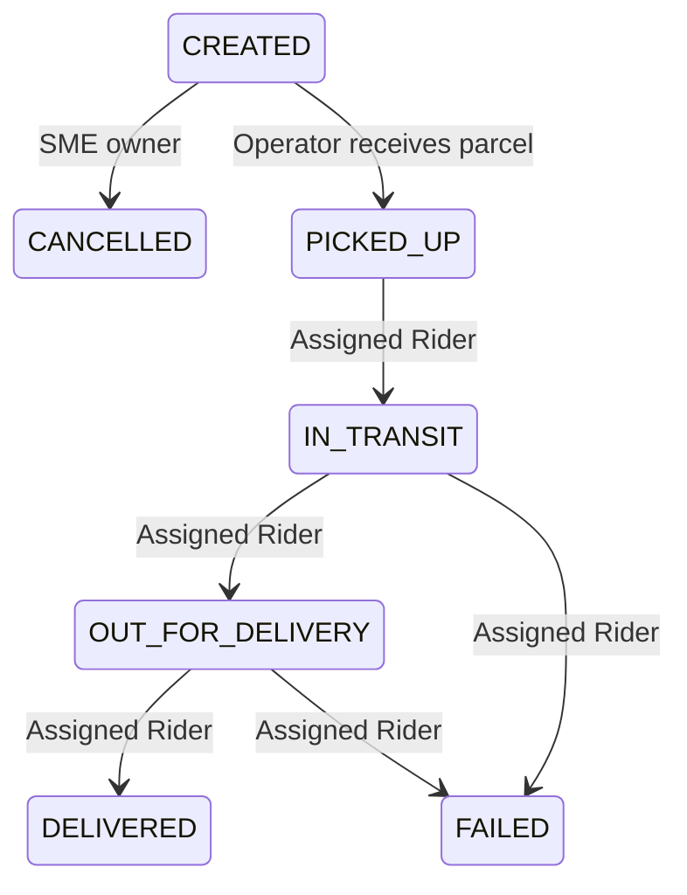

# ParcelOps AI / SurferTrack

A parcel operations application for online shop owners (SMEs), delivery operators, and riders. The repository contains a Next.js web client and an Express REST API backed by PostgreSQL. The interface also uses the SurferTrack brand.

## Features and roles

| Role | Main workflows | Web entry |
| --- | --- | --- |
| SME / Seller | Register, verify email, create parcels, browse own orders, view QR codes and tracking, cancel eligible orders | `/seller` |
| Operator | Review incoming parcels, receive parcels, manage warehouse, provider city pricing, rider invitations and assignments, incidents, and reports | `/operator` |
| Rider | Activate an invitation, complete vehicle/profile onboarding, view assigned deliveries, verify parcel scans, update delivery status, and report incidents | `/rider` |

Shared features include login/logout, password recovery, profile management, validation, and role-based access. Public registration creates SME accounts only. Operators require trusted administrative provisioning; riders join through an Operator invitation. Provider membership and resource ownership are checked by the backend.

## Tech stack and tools

| Area | Technologies |
| --- | --- |
| Web application | Next.js 16 App Router, React 19, TypeScript |
| UI | Tailwind CSS 4, shadcn/ui and Radix UI, Lucide icons |
| Forms and state | React Hook Form, Zod 4, Zustand |
| QR workflows | `qrcode` on the API, `@zxing/browser` for browser scanning |
| API | Node.js, Express 4, TypeScript, Zod, express-rate-limit, CORS |
| Persistence | PostgreSQL (configured examples use Supabase), Prisma 7, `pg` adapter |
| Authentication | Application-managed accounts and database-backed opaque access/refresh tokens |
| Email | Nodemailer with SMTP for verification, recovery, and invitations |
| API documentation | OpenAPI 3.0.3 and Swagger UI Express |
| Development and checks | npm, tsx watch, TypeScript compiler, ESLint, Vitest, Testing Library, Node test runner |

Supabase is used as a PostgreSQL host in the configuration examples. The current authentication implementation does **not** use Supabase Auth or JWTs, despite references in older planning notes. AI/OpenRouter integration is described as future work in backend guidance; it is not an implemented runtime integration.

## Repository structure

```text
Team-17/
|-- README.md
|-- client/
|   |-- app/                 Next.js pages, layouts, and /api/session handlers
|   |-- features/            Auth, orders, operator, riders, deliveries, incidents, profile
|   |-- components/          Shared components and UI primitives
|   |-- lib/                 API client and utilities
|   |-- docs/                Frontend workflow and design guides
|   `-- .env.example
`-- server/
    |-- src/
    |   |-- app.ts           Express middleware and route registration
    |   |-- server.ts        HTTP server entry point
    |   |-- config/          Environment, Prisma, mail, Swagger
    |   |-- modules/         Feature routers, controllers, services, repositories, schemas
    |   |-- middleware/      Authentication, request handling, errors
    |   |-- lib/             Shared OpenAPI, email, and error helpers
    |   `-- seed/            Guarded development setup commands
    |-- prisma/              Database schema and SQL migration history
    |-- tests/               Backend tests, including Swagger route checks
    |-- docs/                API contracts and operational guides
    `-- .env.example
```

The client and server have separate package manifests and lockfiles. Run npm commands in the relevant directory; there is no root npm workspace or root start script.

## Architecture

The backend follows a modular monolith: features share one Express application and database, with separate HTTP, business, and persistence layers.



Controllers validate requests and format responses; services enforce business rules, role permissions, ownership, provider scope, and status transitions; repositories encapsulate database operations. Prisma migrations track schema changes.

Protected browser workflows use Next.js as a backend for frontend. Its `/api/session/*` handlers keep access and refresh tokens in HttpOnly cookies, proxy authenticated requests to Express, and manage refresh rotation. Session requests enforce the configured frontend origin. Public auth requests can call Express through the public API base URL. Swagger and other API clients call Express directly with Bearer tokens.

Core data includes accounts, profiles, sessions, verification/reset tokens, delivery providers and city pricing, parcel orders, status events, rider invitations/profiles/assignments, and incidents. Assignment and status history are separate records from the order's status.

## Local setup

### Prerequisites

- Node.js 24 LTS and npm (the project was inspected using Node 24).
- A PostgreSQL database and a migration-capable connection; a Supabase PostgreSQL project can supply these.
- An SMTP account to complete email verification, password recovery, and rider invitations.

Run these commands from the repository root (`Team-17`).

### 1. Install dependencies

```powershell
cd server
npm ci
cd ../client
npm ci
cd ..
```

The server's postinstall step generates the Prisma client. Regenerate it with `npm run prisma:generate` from `server` after schema changes.

### 2. Configure environments

Copy each example only if the destination does not already exist, preserving existing local settings:

```powershell
if (!(Test-Path server/.env)) { Copy-Item server/.env.example server/.env }
if (!(Test-Path client/.env.local)) { Copy-Item client/.env.example client/.env.local }
```

Edit the copies using real local values. Never commit credentials.

| Server variable | Purpose |
| --- | --- |
| `NODE_ENV` | `development`, `test`, or `production` |
| `PORT` | Use `4000` for the supplied local configuration; the code fallback is `3000`, which conflicts with the default frontend port |
| `DATABASE_URL` | PostgreSQL runtime connection; use the appropriate Supabase pooler URL if applicable |
| `DIRECT_URL` | Migration connection read by `prisma.config.ts`; use a connection supporting schema migrations |
| `FRONTEND_URL` | Set `http://localhost:3000`; controls email links and the allowed browser origin |
| `SMTP_HOST`, `SMTP_PORT`, `SMTP_USER`, `SMTP_PASSWORD`, `SMTP_FROM` | Transactional mail settings; example port is `587` |
| `ENABLE_API_DOCS` | Optional literal `true` or `false`; defaults to enabled outside production |

URL-encode special characters in database passwords. Replace all example placeholders. Set `FRONTEND_URL` explicitly: the server code fallback is `http://localhost:3001`, while the provided client setup uses port `3000`.

| Client variable | Local value and purpose |
| --- | --- |
| `NEXT_PUBLIC_API_BASE_URL` | `http://localhost:4000`; public Express endpoint base, visible to the browser |
| `EXPRESS_API_URL` | `http://localhost:4000`; server-side session proxy target |
| `APP_ORIGIN` | `http://localhost:3000`; exact frontend origin for session request checks |

Keep database and SMTP secrets on the server. Restart development processes after environment changes.

### 3. Apply migrations

After confirming that the connection targets your intended development database:

```powershell
cd server
npm run db:migrate
```

This applies checked-in migrations using `prisma migrate deploy`. For a new schema change, create and review a development migration with `npx prisma migrate dev --name descriptive_name`. Do not substitute a database reset for resolving migration history problems.

### 4. Start both applications

Terminal 1, from `server`:

```powershell
npm run dev
```

Terminal 2, from `client`:

```powershell
npm run dev
```

| Resource | Local URL |
| --- | --- |
| Web application | http://localhost:3000 |
| API health | http://localhost:4000/health |
| Swagger API documentation | http://localhost:4000/api/docs |
| OpenAPI JSON | http://localhost:4000/api/docs.json |

`/health` checks process availability, not database connectivity.

## Usage and delivery workflow

1. Open `/register`, create an SME account, follow the verification email, then sign in at `/login`.
2. In the Seller area, choose an available delivery provider/city price and create a parcel. View its details, QR identifier, and tracking history.
3. Sign in with an administratively provisioned Operator account with provider membership. Configure city pricing as needed, receive an eligible parcel, and invite a rider.
4. The Rider follows the invitation email, activates the account, signs in, and completes profile/vehicle onboarding. Delivery operations require provider membership and a complete profile.
5. The Operator assigns a received parcel to an eligible rider in the same provider. The Rider opens the assignment, uses scan verification where needed, and advances the delivery or reports an incident.



`DELIVERED`, `FAILED`, and `CANCELLED` are terminal. Assignment does not introduce an `ASSIGNED` status. Reporting an incident does not itself change order status. See [the permission policy](server/PERMISSIONS.md) for ownership and transition rules.

An empty database needs provider/pricing setup and trusted Operator provisioning before the complete operational workflow is available. There are no public role-selection APIs or documented universal demo credentials. See [provider provisioning](server/docs/OPERATOR_PROVIDER_PROVISIONING.md) and [rider management](server/docs/OPERATOR_RIDER_MANAGEMENT.md). Guarded setup tools include `seed:providers`, `operator:assign-provider`, `rider:assign-provider`, and `seed:dev`; inspect their required target confirmations and IDs before running them. They are not part of normal startup.

## Swagger and API routes

The existing Swagger routes are registered in [server/src/config/swagger.ts](server/src/config/swagger.ts). Open `/api/docs` on the **backend** port. `/api/docs.json` supplies the machine-readable OpenAPI contract for Swagger or Postman import.

To test authenticated requests:

1. Use `POST /api/auth/register` and `POST /api/auth/verify-email`, or use an existing verified test account.
2. Execute `POST /api/auth/login` and copy `data.accessToken`.
3. Click **Authorize**, paste only the token, then execute a protected request such as `GET /api/users/me`. Swagger adds `Authorization: Bearer <token>`.
4. Refresh with `POST /api/auth/refresh`, supplying `data.refreshToken` in the JSON body. Replace both tokens and update Swagger authorization.
5. Use `POST /api/auth/logout` to revoke the current session, then clear Swagger authorization.

Tokens are opaque, not JWTs. Swagger does not persist authorization across reloads or automatically rotate tokens. API authentication and rate limits still apply to interactive requests.

| Route family | Purpose |
| --- | --- |
| `/api/auth/*` | Registration, email verification, login, refresh, logout, password recovery |
| `/api/users/me` | Read/update authenticated profile |
| `/api/sme/dashboard` | Seller dashboard data |
| `/api/orders/*` | SME orders, detail, QR, status reads and cancellation |
| `/api/delivery-providers`, `/api/delivery/services`, `/api/delivery/cities` | Provider and city discovery |
| `/api/operator/orders/*` | Incoming orders, details, parcel receipt |
| `/api/operator/my-provider/*` | Operator provider details and city prices |
| `/api/operator/warehouse/*` | Warehouse overview and parcel lists |
| `/api/operator/riders/*`, `/api/riders/invitations` | Rider management and invitations |
| `/api/riders/activate` | Public token-based rider activation |
| `/api/operator/assignments`, `/api/operator/reports/overview` | Assignments and operational reporting |
| `/api/rider/profile` | Rider onboarding/profile |
| `/api/rider/assignments/*`, `/api/rider/parcel-scans/verify` | Assigned deliveries, status updates, scan verification |
| `/api/rider/incidents/*`, `/api/operator/incidents/*` | Rider reporting and Operator review |

Route families summarize available functionality; use Swagger for exact methods, request fields, pagination, response schemas, and error codes. Next.js `/api/session/*` routes are the web client's cookie-session boundary; the published Swagger contract describes the Express API.

Most API responses use `{ "success": true, "data": ... }` or `{ "success": false, "error": { "code": "...", "message": "..." } }`. Health returns `{ "status": "ok" }`. Common errors include `400` validation, `401` missing/expired authentication, `403` role or onboarding restrictions, `404` missing/inaccessible resources, `409` workflow conflicts, and `429` rate limits.

Documentation is disabled by default with `NODE_ENV=production`. Set `ENABLE_API_DOCS=true` to enable it explicitly, or `ENABLE_API_DOCS=false` to hide both routes in any environment. Disabled routes return `404`.

For API development, keep each module's `*.openapi.ts` beside its router, reuse [OpenAPI helpers](server/src/lib/openapi.ts), and merge paths/schemas/tags in the Swagger configuration. Request schemas derive from Zod; document actual responses and permissions. See the [Swagger testing guide](server/docs/SWAGGER_API_GUIDE.md) and [API reference](server/docs/API_DOCUMENTATION.md).

## Commands and verification

| Directory | Command | Purpose |
| --- | --- | --- |
| `server` | `npm run dev` | Watch API source with tsx |
| `server` | `npm run build` | Compile TypeScript to `dist` |
| `server` | `npm start` | Run compiled API |
| `server` | `npm test` | Build, then run Node backend tests |
| `server` | `npm run prisma:generate` | Generate Prisma client |
| `server` | `npm run db:migrate` | Apply committed migrations |
| `client` | `npm run dev` | Start Next.js development server |
| `client` | `npm run build` | Build Next.js application |
| `client` | `npm start` | Run built frontend |
| `client` | `npm run lint` | Run ESLint |
| `client` | `npm run typecheck` | Check TypeScript without emitting files |
| `client` | `npm test` | Build backend via pretest, then run Vitest |

Backend tests cover authentication, permissions, business workflows, and documentation. Database integration tests require an explicitly configured `TEST_DATABASE_URL` pointing to a migrated test database; ordinary tests use mocked persistence where applicable. To check Swagger specifically, run `npm run build` followed by `node --test tests/swagger.test.cjs` from `server`.

For deployment, build and start the client and server independently, apply reviewed migrations to the intended database, configure HTTPS origins and SMTP, and set production environment values. `NEXT_PUBLIC_*` variables are included in the frontend build, so set them before building. Production session cookies require HTTPS. The repository does not provide a root deployment orchestrator.

## Troubleshooting

| Symptom | Check |
| --- | --- |
| API fails with invalid environment variables | Replace placeholders in `server/.env`; verify `DATABASE_URL` and literal documentation flags |
| Port conflict or frontend calling the wrong server | Set API `PORT=4000` and align both client API URLs |
| Login blocked pending verification | Configure SMTP, verify the emailed token, then sign in |
| Session request returns `INVALID_ORIGIN` | Match `APP_ORIGIN` to the exact browser origin, including scheme and port; use one hostname consistently |
| Browser CORS error or wrong email-link host | Set `FRONTEND_URL` to the actual frontend origin |
| Swagger returns `404` | Check `NODE_ENV` and `ENABLE_API_DOCS`, then restart the API |
| Rider cannot access deliveries | Confirm account activation, provider membership, completed profile, and assignment ownership |
| No providers/prices or Operator setup required | Follow the controlled provisioning guide and configure active city prices |
| Prisma schema/client errors | Generate the client and check applied migrations; do not reset a shared database |

## Further documentation

- [Vercel deployment settings and readiness results](VERCEL_DEPLOYMENT.md)
- [Backend README](server/README.md) and [authentication implementation](server/AUTH.md)
- [Email verification](server/docs/EMAIL_VERIFICATION.md) and [password reset](server/docs/PASSWORD_RESET.md)
- [Role policy and lifecycle](server/PERMISSIONS.md)
- [Rider onboarding](server/docs/RIDER_PROFILE_ONBOARDING.md) and [delivery API](server/docs/RIDER_DELIVERY_API.md)
- [Warehouse workflow](server/docs/WAREHOUSE_MANAGEMENT.md)
- [Frontend integration](client/docs/DELIVERY_WORKFLOW_INTEGRATION.md) and [design system](client/docs/DESIGN_SYSTEM.md)

Some older planning documents describe earlier phases. Use the implemented routes, Prisma schema, environment examples, and generated Swagger contract to confirm current behavior.
